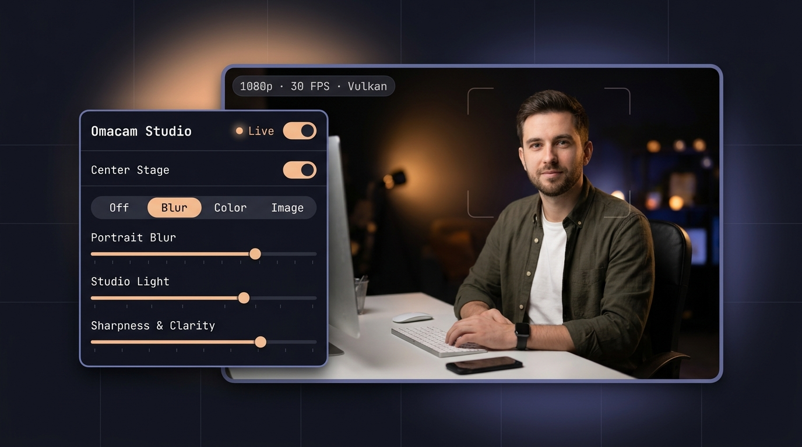

# Omacam Studio

macOS-style system virtual camera daemon & native **Omarchy Shell** bar widget for Linux (PipeWire + Vulkan).

Built in **Rust + WGSL + QML** — zero kernel modules (`v4l2loopback` not required), zero idle CPU usage, real-time 1080p AI portrait studio effects across Brave, Chrome, Discord, Meet, OBS, and any PipeWire camera app.



---

## Features

- **Zero-Kernel Virtual Camera (`PipeWire Video/Source`)**
  Exposes **Omacam Studio** (`NV12 1920×1080 @ 30 FPS`) purely in userspace via `pipewire-rs`. Opens your physical camera (or upstream `aurora-camera-denoise` PipeWire node) strictly **on-demand** when an app starts streaming, and releases it immediately when the call ends.
- **Vulkan GPU AI Matting (`ncnn` FP16 + Cooperative Matrix)**
  Runs **Robust Video Matting (ResNet50, `768×432`)** on Vulkan GPU with temporal recurrent memory (`r1..r4`), `fgr` edge color decontamination (no wall-color halo on hair), and a 1080p **Joint Bilateral edge-guided** alpha upsampler. Automatically falls back to ONNX Runtime CPU (`rvm_mobilenetv3`) if NCNN weights aren't present.
- **Center Stage (`YuNet` ONNX + Catmull-Rom Bicubic GPU Zoom)**
  Automatic face tracking with foreground alpha-mask filtering (ignores faces on posters/books behind you), deadzone hysteresis, critically-damped smooth glide, multi-person auto zoom-out, and crisp Catmull-Rom bicubic zoom.
- **Real-Time Vulkan Image Enhancement (`wgpu` WGSL)**
  - **Motion-Adaptive Temporal GPU Denoiser**: cleans sensor noise on static/slow regions with zero motion ghosting.
  - **2-Stage 8-Channel Residual Restoration CNN**: restores micro-edge clarity (eyes, beard, hair, headphones) without plastic AI artifacts.
  - **AMD FidelityFX CAS + Local Clarity + Black-Point De-Haze**: fixes flat/soft Linux ISP output.
  - **Optical Portrait Bokeh**: 48-tap Golden-Angle disk bokeh with dilated foreground bleed suppression and highlight bloom.
  - **Studio Light**: black-anchored filmic key light tracking your detected face + subtle background dimming/vignette.
  - **Virtual Background**: custom images (integrated with Omarchy's native `omarchy-menu-images` carousel + optional depth blur + subtle Center Stage parallax) or studio seamless gradient colors.
- **Native Omarchy Shell Bar Widget (`vadim-su.omacam`)**
  Theme-aware Quickshell widget (`PopupCard`, `ToggleSwitch`, `ButtonGroup`, `PanelSlider`) with live Unix-socket IPC (`$XDG_RUNTIME_DIR/omacam.sock`), English & Russian translations, live active-camera indicator, and persistent settings (`~/.config/omacam/settings.json`).

---

## Real-World Performance (Apple M5 Max, 1920×1080)

| Stage | Backend | Time / Frame |
|---|---|---|
| RVM ResNet50 (`768×432` FP16) | `ncnn` Vulkan (Cooperative Matrix `16×16×16`) | **16.3 ms** |
| Center Stage (`YuNet` + alpha filter) | `ort` ONNX Runtime (5 Hz + 30 Hz spring) | **2.2 ms** |
| 7 Vulkan WGSL compute passes (Temporal Denoise + 2-Stage CNN + Bokeh + Bicubic Zoom + Guided Matting + CAS + Studio Light + NV12) | `wgpu` Vulkan | **2.1 ms** |
| **Total** | | **20.6 ms** (< 33.3 ms @ 30 FPS) |

---

## Installation

### 1. Install the Omarchy Shell bar plugin only

```bash
omarchy plugin add https://github.com/vadim-su/omacam.git --enable
```

### 2. Full installation (Rust daemon + models + systemd service + bar plugin)

Prerequisites on Arch / Omarchy Linux:
- `pipewire`, `rust`, `clang`, `ncnn` (`sudo pacman -S ncnn`), Vulkan driver (`vulkan-icd-loader`)

```bash
git clone https://github.com/vadim-su/omacam.git
cd omacam
./install.sh
```

In **Brave / Chrome**, make sure `brave://flags/#enable-webrtc-pipewire-camera` (or `chrome://flags/#enable-webrtc-pipewire-camera`) is enabled, then select **Omacam Studio** as your camera.

---

## CLI & Hyprland Keybinds

Every setting can be toggled live over `$XDG_RUNTIME_DIR/omacam.sock`:

```bash
# Inspect live JSON status
omacam ctl status

# Toggle all effects on/off (great for a Hyprland bind!)
omacam ctl toggle

# Adjust individual effects live
omacam ctl set --bg blur --blur 0.75 --studio-light 0.45 --sharpness 0.80
omacam ctl set --center-stage true --center-stage-zoom 0.60
omacam ctl set --bg color --bg-color "#1c2433"
omacam ctl set --bg image --bg-image ~/Pictures/studio.jpg --bg-image-blur 0.2
```

Example Hyprland keybind (`~/.config/hypr/bindings.conf`):

```ini
bindd = SUPER SHIFT, C, Toggle Omacam effects, exec, ~/.local/bin/omacam ctl toggle
```

---

## Architecture

```text
aurora_camera_denoise (PipeWire)  [or /dev/video0 V4L2 fallback]
        │  NV12 1920×1080 @ 30 FPS (on-demand)
        ▼
┌─────────────────────────────────────────────────────────────┐
│  omacam daemon (Rust, systemd --user)                       │
│  1. NCNN Vulkan FP16 RVM ResNet50 (768×432 alpha + fgr)     │
│  2. YuNet ONNX + alpha-filtered Center Stage controller     │
│  3. wgpu Vulkan compute pipeline (7 WGSL passes):           │
│     • NV12 → RGBA8 → Temporal Denoise → 2-Stage CNN Restore │
│     • 48-tap Halo-Free Optical Bokeh                        │
│     • Catmull-Rom Zoom + Edge-Guided Matting + fgr Decontam │
│     • FidelityFX CAS + De-Haze + Studio Light → NV12        │
│  4. PipeWire Video/Source ("Omacam Studio")                 │
└───────────────────────────┬─────────────────────────────────┘
                            │  Unix socket ($XDG_RUNTIME_DIR/omacam.sock)
                            ▼
┌─────────────────────────────────────────────────────────────┐
│  Omarchy Shell Bar Widget (Quickshell / QML)                │
│  • Active camera indicator in top bar                       │
│  • Native PopupCard: Center Stage, Blur, Color, Image,      │
│    Studio Light, Sharpness & Clarity                        │
└─────────────────────────────────────────────────────────────┘
```

---

## License

[MIT](LICENSE)
